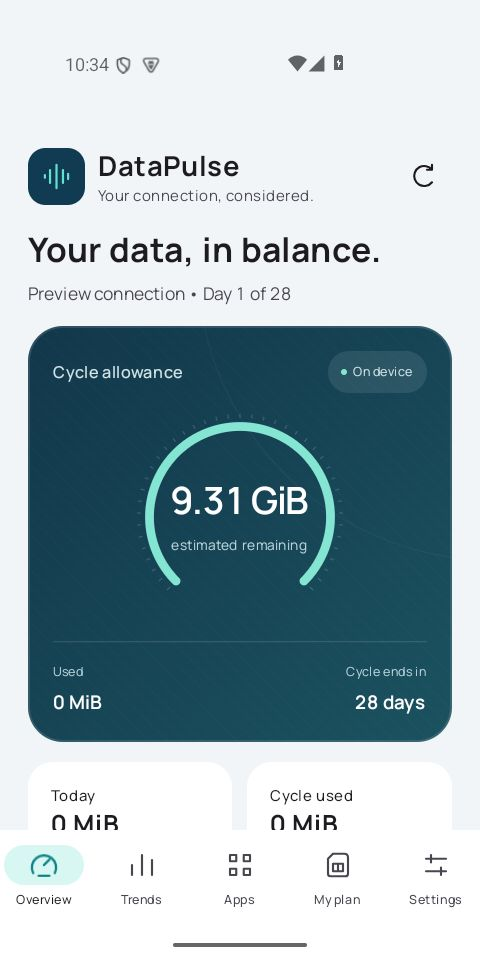
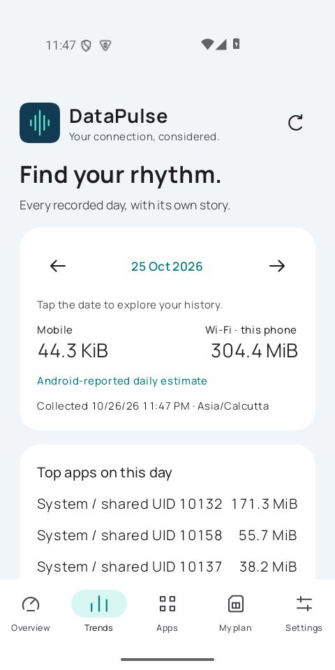
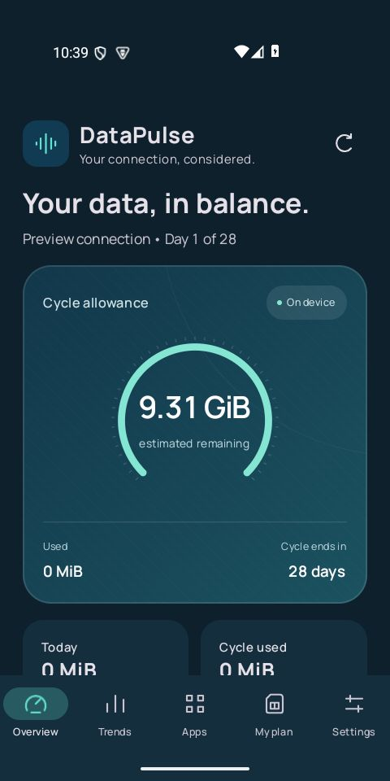
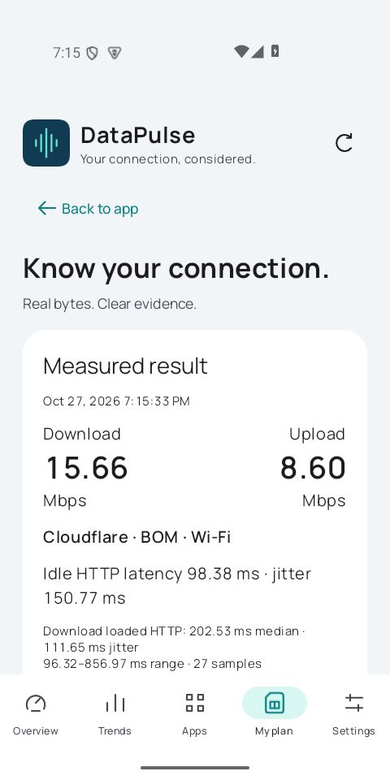
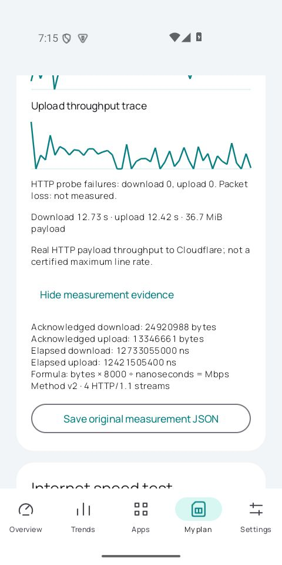

<div align="center">


# DataPulse

### Know your data. Find your rhythm.

A polished Android companion for daily data usage, recharge plans, and real internet measurements.


[](https://github.com/Chatur7x/DataPulse/actions/workflows/ci.yml)

[Download APK](https://github.com/Chatur7x/DataPulse/releases/tag/v0.5.0) · [Validation](docs/VALIDATION_0.5.md) · [Design](docs/PREMIUM_DESIGN.md)

**No signup. No account gate. Your usage history stays on your phone.**

</div>

## A quieter view of your connection

Ocean tones, mint accents, subtle surface textures, bundled Manrope typography, and smooth native transitions. Light and dark themes feel at home on Android.

<table><tr><td align="center"><b>Overview</b><br></td><td align="center"><b>Daily history</b><br></td><td align="center"><b>Dark mode</b><br></td></tr></table>

The history screenshot is from v0.4.0. Overview and dark screenshots show the v0.3 visual foundation retained in v0.5; sample data is for demonstration.

## What you can do

- **Track every recorded day:** browse dates, inspect mobile and Wi-Fi totals, see leading apps, collection time, and partial-day status.
- **Understand patterns:** seven-day summaries, fourteen-day charts, peak usage, and comparisons when enough comparable days exist. Missing records are not shown as measured zero.
- **Manage your allowance:** configure daily-reset or cycle-pool plans manually, track recharges, and view remaining allowance.
- **Measure internet speed:** our Kotlin measurement engine exchanges real payloads with a public Cloudflare endpoint and records download, upload, idle and loaded HTTP latency, jitter, throughput traces, and measurement history. Original samples and exact counters can be exported as JSON.
- **Stay in control:** pause daily collection, export CSV, delete local records, configure optional alerts, and use a home-screen widget.

## Install

Download `DataPulse-0.5.0-preview.apk` from [Releases](https://github.com/Chatur7x/DataPulse/releases/tag/v0.5.0), transfer it to your Android phone, and open it. Allow installation from your chosen installer when Android asks.

This optimized preview uses R8 and resource shrinking. It is development-signed for evaluation, not a production-signed Play Store release. Updates require the same signing key; a locally rebuilt APK may use a different development key.

Open DataPulse and grant **Usage Access** to collect Android network statistics. Notification permission is optional. You can use it without creating an account.

## Measurement and privacy

Usage collection uses Android system statistics and a local Room database. Initial collection attempts up to 31 recent days where Android makes them available; later refreshes reconcile recent days. Hourly background work is best effort and can be delayed by Android. Stored history remains available until deleted. Turning tracking off pauses collection; deleting records leaves tracking paused until enabled again or a new plan is saved.

Mobile statistics can aggregate accessible mobile networks; they are not guaranteed per-SIM. Wi-Fi statistics describe this phone, not every device on your router. Android counters and carrier billing may differ. Usage displays use MiB/GiB; plan entry uses decimal GB.

Speed tests require explicit consent and use HTTPS requests to `speed.cloudflare.com/__down` and `speed.cloudflare.com/__up`. Cloudflare receives your IP and test traffic; the app does not send your app-usage list. Quick and extended modes cap application payload at 64 MiB and 256 MiB respectively; protocol overhead is additional. Upload payloads contain generated bytes, not personal files.

The engine uses four parallel HTTP/1.1 streams, adaptive request sizes, monotonic timing, cache-busting, uncompressed responses, and completed-byte accounting. Idle and loaded HTTP latency are measured separately. [Read the measurement methodology and limitations](docs/SPEED_METHODOLOGY.md). Results measure this route and current conditions, including HTTP overhead; they are not a guaranteed maximum line rate. Latency is HTTP round-trip latency, not ICMP ping. Tests cancel when the screen is left or the app goes into the background. DataPulse does not run Ookla’s proprietary engine or claim a certified 99% accuracy score. Packet loss is not inferred from HTTP failures.

## Build locally

Requirements: JDK 21, Android SDK platform 36 and build tools, and internet access for dependency resolution. Minimum device API: 23. Target API: 36.

```bash
git clone https://github.com/Chatur7x/DataPulse.git
cd DataPulse
```

Open in Android Studio, or set `sdk.dir` in your untracked `local.properties`, then run:

```bash
./gradlew :app:assemblePreview :app:testDebugUnitTest :app:lintDebug
```

On Windows, use `gradlew.bat`. The optimized APK is generated at `app/build/outputs/apk/preview/app-preview.apk`. For a debuggable build, run `:app:assembleDebug`.

```bash
adb install -r app/build/outputs/apk/preview/app-preview.apk
```

No cloud credentials or authentication backend are required.

## Inside the app

| Layer | Implementation |
| --- | --- |
| Interface | Kotlin, Jetpack Compose, Material 3, bundled Manrope |
| State | ViewModels, coroutines, Flow, Hilt |
| Storage | Room v4 with committed schemas and explicit migrations |
| Collection | Android usage/network statistics, WorkManager |
| Speed measurement | Custom Kotlin engine over OkHttp HTTPS transport |
| Validation | JVM tests, Android instrumentation, Google Artemis controller |

```text
app/src/main/       Android app, UI, collection, storage, speed engine
app/src/test/       Accounting, analysis, export and speed-math tests
app/src/androidTest/  Database, migration and live network tests
app/schemas/        Versioned Room schemas
scripts/            Manifest checks and Artemis launcher
tests/artemis/      Device acceptance automation
docs/               Design, validation, screenshots and branding
licenses/           Bundled font license
```

## Tested, with clear limits

The current preview passed **39 JVM tests**, **4 database/migration instrumented tests**, **1 live speed-engine instrumented test**, and **10 Google Artemis controller UI checks**, plus the local builds, lint and manifest checks. The UI checks cover real test completion, cancellation, immediate restart, loaded-latency details, original JSON export, background cancellation, and persistence after process restart.

The v0.4 result-screen validation gap is resolved by the passing v0.5 flow. Earlier automation attempts needed scrolling and lifecycle-wait corrections; they are not counted as passes. Independent Python recalculation verified both the engine record and the actual UI-exported record: final throughput, idle latency, jitter, cap accounting, and every throughput trace point.

[Google Artemis](https://github.com/google/artemis) is an external testing tool, not bundled into the app. These checks use its actual device controller. Autonomous model-driven Artemis validation remains unavailable because of the local provider configuration; no autonomous-agent pass is claimed.

<table><tr><td align="center"><b>Actual measured result</b><br></td><td align="center"><b>Original measurement evidence</b><br></td></tr></table>

Inspect the [original UI-exported JSON](docs/test-results/v05-ui-export-original.json) or [separate live engine record](docs/test-results/v05-engine-original-measurement.json). These contain real observations from different emulator sessions, not example values or promises about your own connection. Recalculate an exported record locally:

```bash
python scripts/verify_speed_result.py docs/test-results/v05-ui-export-original.json
```

Numerical consistency does not prove a 1% measurement error bound or server-signed authenticity. DataPulse remains an independent HTTP measurement engine using Cloudflare, with no Ookla certification. Controlled reference-link testing and paired Ookla comparisons remain release work.

See [current validation](docs/VALIDATION_0.5.md), [methodology](docs/SPEED_METHODOLOGY.md), [Artemis setup](tests/artemis/README.md), and the [physical-device checklist](docs/PHYSICAL_DEVICE_VALIDATION.md). v0.5 was tested on a dedicated Android 15 emulator. v0.4 was previously installed on a Pixel 8a; the phone was disconnected during v0.5 validation, so this version has not yet been installed or measured there.

## Typography and branding

The pulse mark is provided as native Android vector assets and SVG/PNG exports in [docs/branding](docs/branding). Manrope is bundled locally under the [SIL Open Font License](licenses/Manrope-OFL.txt). No remote font request is required.

No general source-code license has been selected for this repository; the font license applies to the font assets only.
